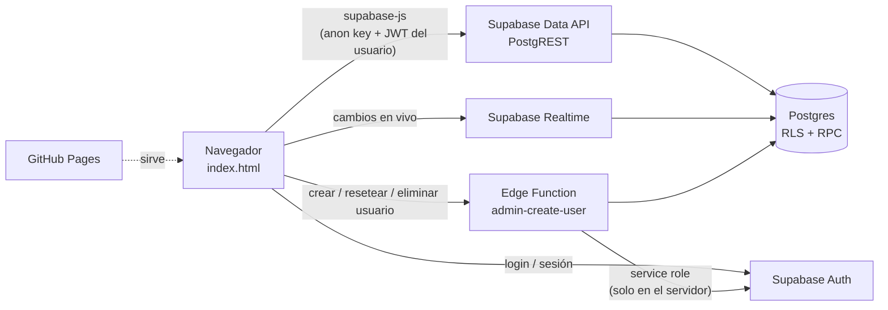
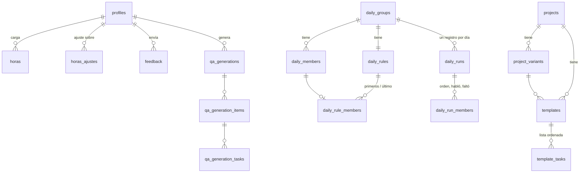
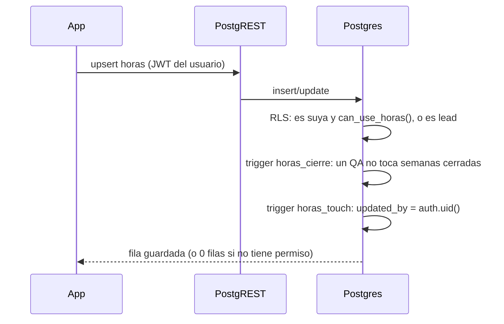

# QA BCR Suite — Arquitectura

Herramienta interna del equipo QA de Babel para el trabajo que hace para el BCR. Reúne en una sola página: generar tareas QA para Azure DevOps, ordenar el Daily, registrar horas, controlar solicitudes y contar días hábiles.

- **Publicada en:** GitHub Pages (`https://braynerrosales.github.io/qa-bcr-suite/`), desde la rama `main`.
- **Datos:** Supabase (Postgres + Auth + Realtime + Edge Functions).
- **Sin servidor propio y sin build:** `index.html` (solo el HTML), `css/styles.css` y un archivo de JavaScript por módulo en `js/`, sin frameworks. Se publican tal cual.

---

## 1. Vista general



**Principio de seguridad:** el navegador solo tiene la *anon key* (pública por diseño). Lo que cada persona puede ver o cambiar lo decide la base de datos con **RLS** (Row Level Security), funciones `security definer` y permisos por columna. Ocultar un botón en la app es solo comodidad; el bloqueo real está en Postgres. La *service role key* existe únicamente dentro de la Edge Function.

---

## 2. Estructura del repositorio

```
index.html                     el HTML de la app (pantallas y diálogos) y la CSP
css/styles.css                 estilos (tokens de color, modo oscuro, responsive)
js/                            JavaScript sin build, cargado en este orden por index.html:
  config.js                    URL de Supabase y anon key
  base.js                      modelo de datos (get_app_config, copia local) y navegación
  qa.js daily.js admin.js solicitudes.js horas.js calc.js   un archivo por módulo
  auth.js                      sesión, permisos por rol y contraseña
  feedback.js usuarios.js      Feedback y Administración → Usuarios
  acciones.js                  qué hace cada botón (data-click, data-change…; ver §7)
  init.js                      arranque: va último, cuando ya existen todas las funciones
img/                           logos (Babel en login y menú; BCR solo después de iniciar sesión)
supabase/
  migrations/                  esquema, RLS y funciones, en orden de fecha (se corren en el SQL Editor)
  functions/admin-create-user/ Edge Function (Deno) para administrar usuarios
  tests/                       pruebas SQL de permisos (terminan en ROLLBACK, no dejan datos)
  alinear-base-existente.sql   ajusta una base creada antes de las migraciones (solo antes de 20261016…)
scripts/migrate-data.mjs       convierte el JSON de la app vieja en seed.sql / verify-seed.sql
local-test/                    imitación mínima de Supabase para probar en un Postgres local
tests/test-auth.mjs            pruebas de punta a punta (Playwright + Supabase simulado)
.github/workflows/pruebas.yml  GitHub Actions: corre esa prueba en cada PR
app/cambios-fase2.diff         registro de los cambios de la Fase 2 sobre el HTML original
.claude/                       skills de diseño y verificación (taste-skill, web-design-guidelines, playwright-cli)
CLAUDE.md                      regla de trabajo para cambios de UI
README.md                      guía de instalación y de cada módulo
```

**No se suben al repositorio** (contienen nombres del equipo o datos reales): `seed.sql`, `verify-seed.sql`, los scripts de carga de solicitudes, los JSON/Excel de datos y `graphify-out/`.

---

## 3. Roles y permisos

| Rol | Generar tareas | Daily | Días hábiles | Horas | Solicitudes | Administración | Usuarios / Feedback |
|---|---|---|---|---|---|---|---|
| **ADMIN** | ✓ | ✓ | ✓ | Todas + ajustes + elegir personas del informe | ✓ | ✓ | ✓ |
| **QA_LEAD** | ✓ | ✓ | ✓ | Todas + ajustes | ✓ | ✓ (sin Usuarios ni Feedback) | — |
| **QA** | ✓ | ✓ | ✓ | Solo las suyas; ve el consolidado final | — | — | — |
| **BETA** | ✓ | ✓ | ✓ | — | — | — | — |

Todos los roles pueden **enviar feedback** y **cambiar su contraseña**. Un usuario desactivado (`active = false`) no ve nada.

Funciones de apoyo en el esquema `private` (no expuesto por la API):

| Función | Devuelve true si… |
|---|---|
| `private.app_role()` | (devuelve el rol del usuario actual si está activo, o null) |
| `private.is_active_user()` | tiene sesión y está activo |
| `private.is_lead()` | es ADMIN o QA_LEAD activo |
| `private.is_admin()` | es ADMIN activo |
| `private.can_use_horas()` | está activo y no es BETA |
| `private.horas_abiertas_desde()` | lunes de hace dos semanas (hora de Costa Rica): antes de esa fecha un QA no toca sus horas |

---

## 4. Modelo de datos



| Área | Tablas | Notas |
|---|---|---|
| Usuarios | `profiles` | 1 a 1 con `auth.users` (trigger `handle_new_user`). Rol, activo, `en_informe`, primer/último ingreso, `must_change_password`. El trigger `profiles_mantener_admin` impide quedarse sin ADMIN activo. |
| Daily | `daily_groups`, `daily_members`, `daily_rules`, `daily_rule_members` | Personas de cada daily y reglas del sorteo (quiénes pueden empezar, rango, último fijo). |
| Daily · historial | `daily_runs`, `daily_run_members` | Un registro por daily por día (`unique (daily_group_id, run_date)`); guarda el nombre aunque la persona se borre. |
| Generar tareas | `projects`, `project_variants`, `templates`, `template_tasks` | Plantillas por proyecto y variante (`variant_id null` = sin variante). |
| Historial QA | `qa_generations`, `qa_generation_items`, `qa_generation_tasks`, `ai_usage_log` | Preparadas para guardar lo generado y, a futuro, el uso de IA vía Edge Function. |
| Solicitudes | `solicitudes` | Lista compartida: informe semanal, encargados (texto), horas, casillas de plan/cierre, fecha de cierre, notas, cerrada. |
| Horas | `horas`, `horas_ajustes` | Líneas por persona y día; ajustes de leads guardados como **diferencia** (delta) por semana. Un QA solo cambia la semana actual y las dos anteriores (trigger `horas_cierre`). |
| Feedback | `feedback` | Autor y fecha los pone un trigger; máximo 20 por persona por día. |

Columnas de auditoría: `updated_at` / `updated_by` los pone siempre un trigger (`*_touch`) con `auth.uid()`; el navegador no puede falsearlos.

---

## 5. Funciones RPC (llamadas desde la app)

| Función | Para qué | Seguridad |
|---|---|---|
| `get_app_config()` | Devuelve personas, reglas y proyectos con la forma del JSON original de la app | invoker (respeta RLS) |
| `save_template(project, variant, tasks)` | Reemplaza la lista de tareas de una plantilla en una transacción | invoker; solo leads |
| `horas_resumen(desde, hasta)` | Consolidado por persona: feriado, facturable, no facturable, licencia, vacaciones, total (con ajustes ya sumados) | definer; activos no BETA; solo personas `en_informe` |
| `daily_guardar(grupo, fecha, miembros)` | Guarda o reemplaza el daily del día (fecha entre hace 7 días y mañana) | definer; activos |
| `daily_historial(grupo, desde, hasta)` | Historial de un daily (máx. 1 año) | definer; activos |
| `admin_user_access()` | Primer/último ingreso y estado de contraseña de cada usuario | definer; solo ADMIN |
| `admin_cerrar_sesiones(usuario)` | Borra las sesiones de un usuario (al darle contraseña nueva) | definer; solo `service_role` |

Todas las `security definer` usan `set search_path = ''` y validan rol y parámetros antes de tocar datos.

---

## 6. Edge Function `admin-create-user`

Deno, desplegada en Supabase con *Verify JWT* desactivado (la función valida el token por su cuenta).

1. Verifica el JWT del que llama y que sea **ADMIN activo**.
2. Según `action`:
   - *(sin action)* **crear usuario**: correo, nombre, rol (`ADMIN`, `QA_LEAD`, `QA`, `BETA`) y contraseña temporal (10–72 caracteres). El perfil nace con `must_change_password`.
   - `reset_password`: nueva contraseña temporal; cierra sus sesiones abiertas con `admin_cerrar_sesiones()` (solo `service_role`).
   - `delete_user`: elimina de Auth (no a sí mismo). Rechaza (409) a quien tenga horas o ajustes de horas, para no cambiar informes ya enviados; la base lo impide también (`on delete restrict`). Su historial del QA Generator se borra y en solicitudes y feedback queda el registro sin autor.
3. Usa la *service role key* desde las variables de entorno de Supabase; nunca llega al navegador.

---

## 7. La app (`index.html`, `css/`, `js/`)

### Carga y sesión
1. Carga `supabase-js` (versión fija desde jsDelivr, con SRI) y aplica una **CSP** estricta: solo los scripts de `js/` y ese archivo (sin `'unsafe-inline'`), conexiones solo al proyecto de Supabase.
   - Por eso el HTML no lleva `onclick` ni `onchange`: cada botón o campo dice qué función llama con `data-click`, `data-change`, `data-input`, `data-submit` o `data-enter`, y sus argumentos en `data-args` (JSON). `js/acciones.js` escucha esos eventos en `document`; si la función necesita el elemento o sus `data-*`, está en `ACCIONES`.
   - Los archivos de `js/` son scripts clásicos (no módulos) y comparten las funciones globales. Un archivo nuevo va antes de `acciones.js` e `init.js`.
2. Pantalla de login (público: solo logo de Babel). Si `must_change_password`, obliga a cambiar la contraseña antes de entrar.
3. `loadConfig()` trae la configuración por `get_app_config()`. Se guarda una copia en `localStorage` solo como respaldo de lectura si Supabase no responde (aviso «Sin conexión»; no se puede guardar).
4. `applyPermissions()` muestra u oculta secciones según el rol; `showPage()` además bloquea entrar por código a una página sin permiso.

### Módulos (un archivo por módulo en `js/`)

| Módulo | Qué hace | Datos |
|---|---|---|
| Inicio | Saludo y accesos según rol; logo del BCR (se carga después del login) | — |
| Generar tareas | PBIs/HUs/RTs → tareas con la plantilla del proyecto y variante; copiar a Azure DevOps | `projects`, `templates` |
| Daily · Daily de hoy | Sorteo con reglas, marcar quién habló o faltó, guardar el día | `daily_*`, `daily_guardar` |
| Daily · Historial | Semana (días) o Mes (asistencia % por persona + días) | `daily_historial` |
| Horas · Mis horas | Líneas por día (tipo, Soli, tarea, horas, facturables); guardado al salir del campo | `horas` |
| Horas · Consolidado | Semana o mes por persona; leads ajustan números (en semana) con motivo; copiar a Excel | `horas_resumen`, `horas_ajustes` |
| Solicitudes | Lista compartida en vivo (Realtime), filtros, vencidas, encargados del Daily; **Informes semanales**: mensaje de Teams con las horas de envío + tabla Solicitud / Informe semanal / Encargados (copiar o imprimir) | `solicitudes` |
| Días hábiles | Días entre fechas sin fines de semana, feriados de Costa Rica ni días libres | local |
| Administración | Personas y reglas del Daily, proyectos y plantillas, respaldo JSON; Usuarios y Feedback (solo ADMIN) | varias + Edge Function |
| Feedback | Cualquier usuario envía; solo ADMIN lee, marca leído y elimina | `feedback` |

### Diseño
- Tokens de color en `:root` con modo oscuro automático; azul institucional y un solo acento (naranja de Babel).
- Tipografía Public Sans (cifras tabulares en tablas); IBM Plex Mono solo para editar plantillas.
- Accesibilidad: foco visible, etiquetas en todos los campos, Daily usable con teclado, `prefers-reduced-motion`, sin zoom bloqueado.
- Responsive: menú lateral en computadora y barra superior en celular; tablas anchas se desplazan dentro de su recuadro.

---

## 8. Flujos clave

**Guardar una línea de horas**



**Consolidado con ajustes:** `horas_resumen` suma las horas reales (`h`) y los deltas de `horas_ajustes` (`a`) por persona. Un QA solo ve el número final; el detalle de los ajustes (quién, motivo) lo leen únicamente los leads.

**Solicitudes en vivo:** la tabla está publicada en Supabase Realtime; los cambios de otros leads llegan solos sin pisar lo que se está escribiendo.

---

## 9. Pruebas y verificación

| Tipo | Archivo | Cómo |
|---|---|---|
| Punta a punta | `tests/test-auth.mjs` | Playwright con el cliente real de supabase-js y un Supabase simulado en la red; ~99 comprobaciones (login, permisos por rol, cada módulo, móvil, sin errores de JS ni de CSP, sin manejadores inline) |
| Automática (CI) | `.github/workflows/pruebas.yml` | GitHub Actions corre la prueba de punta a punta en cada PR y en cada push a `main`; si falla, guarda las capturas como artefacto |
| Permisos en la base | `supabase/tests/*.sql` | Se corren en el SQL Editor; imprimen «OK …» o abortan con «FALLO …» y terminan en ROLLBACK |
| Postgres local | `local-test/` | Imitación de Supabase para probar migraciones antes de correrlas en la base real |
| UI | `CLAUDE.md` | Revisar con taste-skill y web-design-guidelines, y verificar con capturas de Playwright CLI antes de dar un cambio por terminado |

---

## 10. Despliegue y operación

1. **App:** push a `main` → GitHub Pages publica `index.html`, `css/`, `js/` e `img/`. Los usuarios recargan con Ctrl+F5 (GitHub Pages guarda los archivos en caché unos minutos).
2. **Base:** cada migración nueva se corre una vez en el SQL Editor de Supabase, en orden de fecha (si el editor cambió de rol, empezar con `reset role;`).
3. **Edge Function:** se vuelve a desplegar a mano (Code → Deploy) cuando cambia `supabase/functions/admin-create-user/index.ts`.
4. **Cargas de datos** (solicitudes desde Excel, seed inicial): scripts SQL generados aparte, idempotentes, que emparejan por código (P3_081, OPC_47) y nunca borran; no se suben al repo.

### Reglas de seguridad del proyecto
- Nunca subir secretos ni la *service role key* al repo o al HTML.
- Registro público de usuarios desactivado en Supabase; los crea solo un ADMIN.
- *Site URL* de Supabase apuntando a la URL de GitHub Pages.
- Nada con nombres del equipo en el repositorio; los datos de prueba usan nombres inventados.
